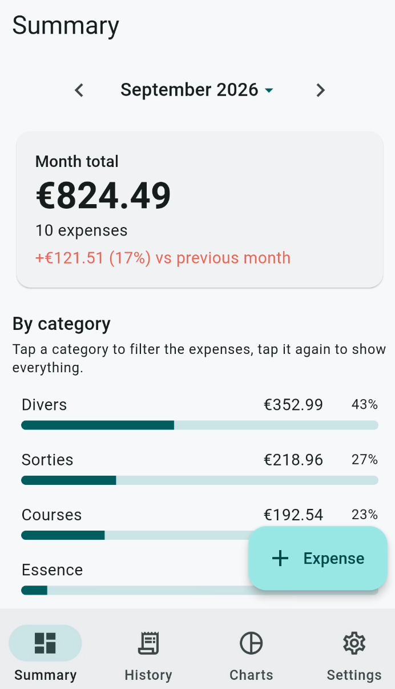
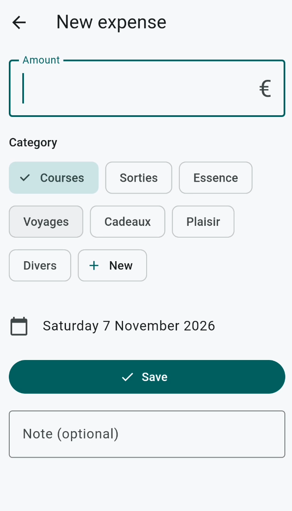
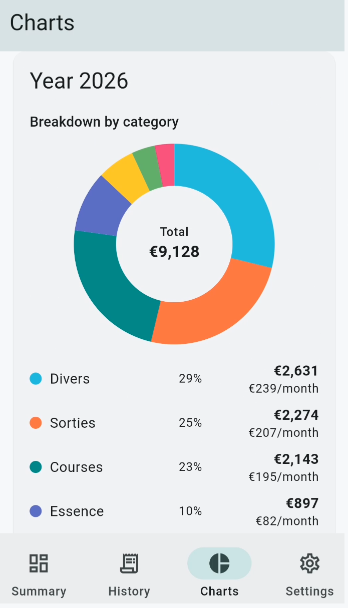
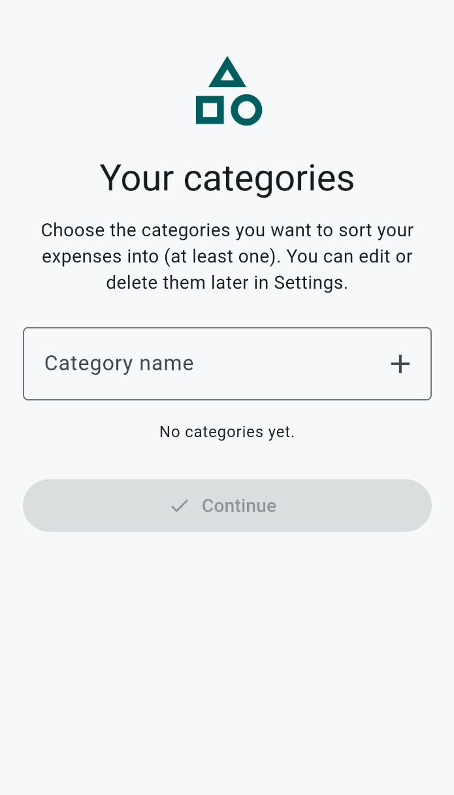
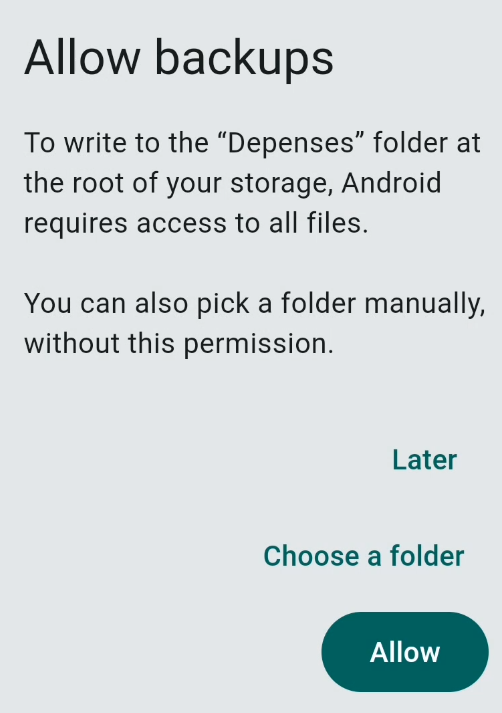

# BankNote

**BankNote** is a simple, private Android app for tracking your expenses.
Record your expenses, organize your budget, visualize your habits.

All your data stays **on your phone**: no account, no server, no internet connection required.

<p align="center">
  

## Features

### Recording expenses

* Quick entry of an expense: amount, category, date and an optional note.
* Edit an expense by tapping it, delete it by swiping left (with the option to undo).

<p align="center">
  

### Fully customizable categories

* No imposed categories: on first launch, you choose your own (at least one).
* They are always displayed, even when they have no expenses yet.
* You can add, rename or delete them at any time from Settings. When you delete one, its expenses are moved to the category of your choice.

### Summary

* Month navigation at the top of the screen (arrows or month picker).
* Month total and comparison with the previous month.
* Breakdown by category with percentages and progress bars.
* **Category filter**: tap a category to see only its expenses, tap it again (or “Show all”) to go back to the full view.
* Detailed list of the month's expenses.

### History

* Browsable yearly bar chart (previous / next year).
* Year total and list of the 12 months with their totals; tapping a month selects it in the Summary.

### Charts

* Expense breakdown by category (donut chart), for a chosen year and for your whole history.
* Monthly average spending, by year and by category.

<p align="center">
  

### Settings

* **Appearance**: 11 colors to choose from, light, dark or automatic theme.
* **Security**: fingerprint lock (or the phone's PIN as a fallback), required on opening and after 30 seconds in the background.
* **Automatic backup**: each time the app opens, a CSV file is written to the `Depenses` folder (or to a folder of your choice). Only the **last 3 backups** are kept (automatic rotation).
* Manual **CSV export / import**.

### CSV import

* Import your history from a spreadsheet or another app.
* Automatic detection of the separator (`;`, tab or `,`), the encoding and the columns (date, amount, category, note).
* Dates accepted in `dd/mm/yyyy` or `yyyy-mm-dd` format, amounts with a comma or a dot.
* Duplicates are ignored, and categories in the file that don't exist yet are automatically added to your list.

Export format:

```csv
date;montant;categorie;note
```

### Language

The app follows the phone's language: **French** or **English** (English by default for any other language).

## First launch

1. Welcome pop-up.
2. Entering your categories.

<p align="center">
  
	   
	   
3. Write permission request for the automatic backup (access to files, or manually choosing a folder, without this permission).


<p align="center">
  
	   
	   
	   
## Installation and build

Requirements: [Flutter](https://docs.flutter.dev/get-started/install) and the Android SDK.

```bash
git clone <repository-url>
cd <folder>
flutter pub get
flutter run                 # run on a phone or an emulator
flutter build apk --release # build the APK
```

## Technical details

* **Flutter / Dart**, Material 3 interface.
* **SQLite** (`sqflite`) for expenses, `shared\\\_preferences` for settings.
* `local\\\_auth` (biometric lock), `file\\\_picker` (import / export), `intl` (languages, dates, amounts).
* Hand-drawn charts, with no external dependency.
* Automatic backup through a small native Android bridge (Kotlin).
* Personal version and public version built from the same codebase.

## Privacy

No data is sent online. Expenses are stored in the app's local database, and CSV backups are written only to the folder you have chosen.

## Project history

BankNote started as a replacement for a daily expenses Excel file, then became a mainstream app.


Support my work !


bc1qpr2044vrd49tr59nxrtutvxxp0t3p5t402pv25

